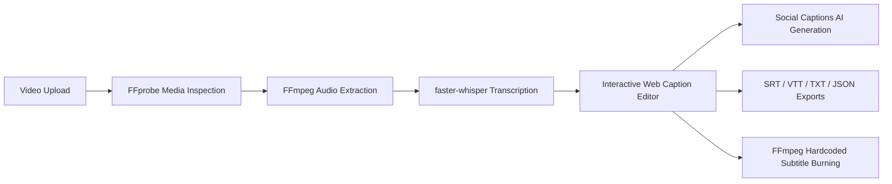

# Capzee — End-to-End Testing & Pipeline Verification

This document details the end-to-end testing workflow for the Capzee video captioning and smart editing platform.

---

## 1. Verified Pipeline Stages

The platform validates the following video processing lifecycle:



### Stage 1: Video Ingestion
- User imports video file (`.mp4`, `.mov`, `.webm`) up to 500 MB.
- Web app creates project record via `POST /api/v1/projects` and uploads binary via `POST /api/v1/projects/:id/media` (multipart/form-data).
- API stores file in `services/api/uploads/` and assigns absolute path to `originalAssetPath`.

### Stage 2: Media Inspection
- Invoked via `capzee_worker.media.inspector.inspect_media()`.
- Validates container formats, duration, video codec, audio codec, and confirms audio stream presence.
- Actionable error emitted if stream lacks audio (`NO_AUDIO_STREAM`).

### Stage 3: Audio Extraction
- Invoked via `capzee_worker.media.extractor.extract_audio()`.
- Uses FFmpeg to transcode input stream to 16kHz mono PCM WAV (`pcm_s16le`).
- Audio files are stored in a managed temporary directory and cleaned up after processing.

### Stage 4: AI Speech Transcription
- CLI script `services/ai-worker/capzee_worker/scripts/transcribe_cli.py`.
- Transcribes using `faster-whisper` (int8 quantized models: tiny, base, small, medium, large).
- Generates word-level timestamps (`start`, `end`, `confidence`) and segment sentences.
- Emits real-time progress events (`{"type": "progress", "progress": int, "stage": str}`) to track job execution.
- Returns validated JSON transcript conforming to `@capzee/contracts` schemas.

### Stage 5: Interactive Web Editor
- Web app loads transcript synchronized with HTML5 video player.
- Allows real-time subtitle text editing, segment splitting/merging, word editing, and time shifting.
- Supports 6 preset viral styles: MrBeast Pop, Hormozi Bold, Minimal Subtitle, Podcast Style, Neon Accent, Educational.
- Aspect ratio preview toggle: 9:16 (TikTok/Reels), 16:9 (YouTube), 1:1 (Square).

### Stage 6: Social Post Captions Generation
- Generates tailored post captions with hashtags and call-to-actions for TikTok, Instagram Reels, YouTube Shorts, LinkedIn, and X/Twitter.
- Supports deterministic local mode (`CAPZEE_LLM_PROVIDER=mock`), local Ollama (`ollama`), or cloud providers (OpenAI, Gemini, Anthropic).

### Stage 7: Subtitle Export
- Instant browser or API downloads:
  - `GET /api/v1/projects/:id/export?format=srt` (SubRip `.srt`)
  - `GET /api/v1/projects/:id/export?format=vtt` (WebVTT `.vtt`)
  - `GET /api/v1/projects/:id/export?format=txt` (Plain text `.txt`)
  - `GET /api/v1/projects/:id/export?format=json` (Full schema `.json`)

### Stage 8: Burned-in MP4 Video Rendering
- CLI script `services/ai-worker/capzee_worker/scripts/render_cli.py`.
- Formats Advanced SubStation Alpha (`.ass`) file with typography, outline, shadow, margins, and active-word highlights.
- FFmpeg burns subtitles into video using `-vf subtitles='<path>'` with `libx264` and `aac`.
- Output video exported to `services/api/exports/` and downloadable via `GET /api/v1/projects/:id/export?format=mp4`.

---

## 2. Automated Test Verification Results

All automated test commands have been run and verified passing:

1. **AI Worker Pytest Suite**:
   ```bash
   python -m pytest services/ai-worker/tests/
   # Result: 20 passed, 0 failed
   ```
2. **Contracts TypeScript Contracts & Generators Suite**:
   ```bash
   node --experimental-strip-types --test packages/contracts/tests/contracts.test.ts
   # Result: 11 passed, 0 failed
   ```
3. **API Server REST Endpoints & Pipeline Suite**:
   ```bash
   node --experimental-strip-types --test services/api/tests/api.test.ts
   # Result: 20 passed, 0 failed
   ```
4. **Web Studio Formatting & Utility Suite**:
   ```bash
   node --experimental-strip-types --test apps/web/tests/utils.test.ts
   # Result: 10 passed, 0 failed
   ```

**Total Verified Automated Tests**: **61 passed, 0 failed**.
